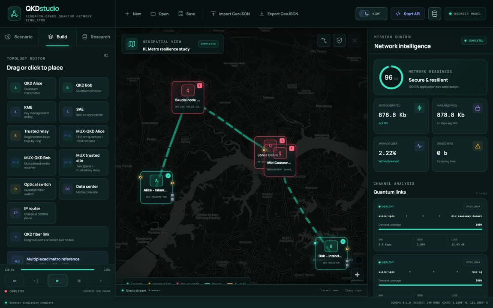

# QKD Studio

**A reproducible discrete-time testbed for service-management and closed-loop control experiments in quantum-key-distribution networks.**

QKD Studio is a cross-platform research simulator that studies quantum key
distribution (QKD) at the *service-management* layer — key-pool planning,
routing and scheduling of key demand, service continuity under bursty traffic,
and resilience under attack — rather than at the physical or entanglement
fidelity layer targeted by most existing quantum-network simulators. It pairs a
geospatial topology editor with a deterministic, seeded Rust engine and exposes
a local REST/WebSocket control API through which external controllers observe
per-tick telemetry and inject management actions.

This work supports the manuscript *“QKD Studio: A Reproducible Discrete-Time
Testbed for Service-Management and Closed-Loop Control Experiments in Quantum
Key Distribution Networks”* (Rahaman and Mahmud), submitted to **IEEE
Transactions on Network and Service Management (TNSM)**.

---

## ⚠️ Code availability

**The source code is not publicly available.** The QKD Studio engine, control
plane, and experiment harness are the subject of an active **patent
application** and are protected by copyright. To preserve the novelty required
for that filing, the implementation is withheld at this time.

What **is** published in this repository:

- 📦 **Installers** of the desktop application for **macOS** (Apple silicon) and
  **Windows** (x64), distributed through GitHub Releases, with install instructions
  below.
- 🐳 A **container image that reproduces every table and figure of the paper** with
  the compiled engine and checks the regenerated values against the reported ones,
  together with the Docker files that run it ([docker/](docker/),
  [REPRODUCIBILITY.md](REPRODUCIBILITY.md)).
- 🗺️ A **Malaysia–Singapore cross-border QKD scenario screenshot**.
- 🎥 A **recorded demo walkthrough** of the running application (below).
- 🗂️ The **repository structure** (folder layout only — placeholder directories,
  no source).
- 📄 This research overview and the system/methodology description.

The installers and the container image contain compiled programs, not source. The
full artifact (engine, controllers, topologies, datasets, and analysis scripts) is
intended to be released, with an archival DOI, once intellectual-property protection
is secured and the manuscript is published. For collaboration or evaluation access in
the meantime, please contact the authors (below).

---

## Install the desktop application

Download the installer for your system from the
[**v0.3.0 release**](https://github.com/muntakim1/qkd-geo-simulator/releases/tag/v0.3.0).
Each file has a SHA-256 checksum in `SHA256SUMS.txt` on the same page.

### macOS (Apple silicon)

1. Download `QKD.Geo.Simulator_0.3.0_aarch64.dmg`.
2. Open the disk image and drag **QKD Geo Simulator** into **Applications**.
3. The build uses an ad-hoc signature and is not Apple-notarized. On first launch,
   right-click the app, choose **Open**, and confirm; if macOS still blocks it,
   allow it under **System Settings → Privacy & Security**.

Requires macOS on Apple silicon (`arm64`). There is no Intel build.

### Windows (x64)

1. Download `QKD.Geo.Simulator_0.3.0_x64-setup.exe`.
2. Run the installer. It is not code-signed, so Windows SmartScreen may show
   “Windows protected your PC”; choose **More info → Run anyway**.
3. The application uses the Microsoft Edge WebView2 runtime, which is part of
   Windows 11 and of current Windows 10. If it is missing, the installer downloads it.
4. Start **QKD Geo Simulator** from the Start menu.

The Windows installer is new in this release and is produced by an automated build;
please report problems through the issue tracker of this repository.

### First run

The application opens with a demo topology. To run the scenario of the paper, open
the **Scenario** tab, choose **Policy-study mesh**, and press **Run**. The
**Research** tab then shows the *run record* of the finished run: engine version,
seed, hashes of the topology and of the settings, a digest of the result, and the
service metrics reported in the paper. The map needs an internet connection; without
one the topology is drawn on a plain background and everything else works.

## Reproduce the results of the paper with Docker

The container image runs every experiment of the paper with the compiled engine and
then compares fourteen regenerated tables and data files with the reported values.
It needs only [Docker](https://docs.docker.com/get-docker/) and takes about 8 minutes
on an Apple-silicon laptop.

```bash
git clone https://github.com/muntakim1/qkd-geo-simulator.git
cd qkd-geo-simulator
bash docker/reproduce.sh
```

The script downloads the image for your processor architecture from the release,
verifies its checksum, loads it, and runs it. A successful run ends with:

```text
All 14 regenerated outputs match the shipped results.
Reproduction workflow completed successfully.
```

The regenerated tables, data, and figures are written to `qkd-output/`.
[REPRODUCIBILITY.md](REPRODUCIBILITY.md) gives the manual steps, explains what is
checked, and shows how to replay a run made in the desktop application.

## Malaysia–Singapore cross-border QKD scenario



The geospatial view models a point-to-point C-band QKD route from Alice at the
Iskandar Puteri Data Centre in Johor, through the Skudai, Johor Bahru, and Mid
Causeway measurement points, to an intended receiver in Singapore. The scenario
reproduces the measured Malaysian section (38.513 km and 12.03 dB span loss) and
supports forward loss-budget studies for the unresolved Singapore section.

---

## Demo walkthrough

https://github.com/muntakim1/qkd-geo-simulator/raw/main/docs/demo/qkd-studio-demo.webm

A short recorded walkthrough of the desktop application: a route-redundant
metropolitan mesh is loaded onto a real-world map, the deterministic engine is
run under a denial-of-key attack, and the dashboard updates per-link key flow
together with live service KPIs (capacity, QBER, application satisfaction). The
video file is at
[docs/demo/qkd-studio-demo.webm](docs/demo/qkd-studio-demo.webm).

## Abstract

Quantum key distribution (QKD) networks deliver cryptographic keys as a service, and
many of their operational bottlenecks arise in the management layer: how key demand
is routed over trusted relays, how contended key pools are shared, and when a service
may fall back to post-quantum cryptography (PQC). We present QKD Studio, a
discrete-time testbed for reproducible experiments on these decisions. A
deterministic, seeded engine models channel loss, secret-key generation, classical
post-processing, per-link key pools, multi-hop key consumption, and parametric
disturbances; a local REST/WebSocket interface lets an external controller observe
per-tick telemetry and inject management actions; and every run records its seed,
configuration hash, and engine version together with a per-tick dataset. Service
accounting is defined end to end per session, conserves key on every hop, and
separates key supplied by QKD from key supplied by PQC.

We use the testbed in two validation studies. First, a full routing-by-scheduler
grid on a route-redundant metropolitan mesh, over 30 seeds, shows that the routing
policy alone determines aggregate QKD-native satisfaction (from 0.12 to 0.85 at a
load equal to the network's QKD capacity), whereas the scheduler leaves the aggregate
unchanged and determines only how fairly key is shared (Jain index from 0.19 to
1.00). The policy ranking is preserved when key-generation parameters, the
secret-key-rate model, and the post-processing model are varied, and total
satisfaction under PQC fallback is shown to be a function of the fallback capacity
and of the share of sessions permitted to use it. Second, a closed-loop key-source
selection study compares a contextual EXP3 bandit with a rule-based controller that
uses the same disturbance observation: the rule attains the reward of a clairvoyant
reference, and the bandit reaches 89% of it, so the gain over context-free policies
is attributable to the disturbance information rather than to learning. The
physical-layer models are simplified and replaceable; all conclusions are relative
comparisons within the released scenarios.

## Research contributions

- **A management-layer simulation model with conserving, source-separated
  accounting.** Link key rates are derived from channel and protocol parameters,
  post-processing is modelled, and key is consumed hop by hop along trusted-relay
  paths. Service is measured end to end per session, the key debited from each link
  equals the QKD key delivered over it, and QKD-supplied and PQC-supplied service are
  reported separately.
- **A control interface for external controllers.** A local REST/WebSocket interface
  exposes per-tick telemetry and accepts routing, scheduling, key-budget, and
  key-source actions, so that rule-based and learning controllers run against the
  same engine.
- **A reproducibility method and a runnable artifact.** Every run is identified by
  its seed, configuration hash, and engine version; datasets are exported per tick;
  and a container regenerates every table and figure of the paper and checks them.

The two experimental studies are validation of the testbed, not contributions in
themselves.

## System architecture

QKD Studio is delivered as a cross-platform desktop application. A Tauri host
embeds a system WebView that renders a React/TypeScript frontend, while the
authoritative simulation engine is implemented in Rust.

- **Geospatial editor (frontend).** A MapLibre map on which an experimenter places
  nodes (QKD transmitter/receiver, KME, SAE, trusted relay, optical switch, data
  center, IP router) and draws links over a real-world map; topology is persisted
  as GeoJSON.
- **Deterministic engine (Rust).** A seeded discrete-time core modelling channel,
  protocol, key-pool, demand, scheduling, and attack dynamics. The authoritative
  results, persistence, dataset export, and control-plane bridge require the
  desktop runtime.
- **Service-control plane.** A local Axum REST/WebSocket API exposing per-tick
  telemetry and management-action injection for external controllers.
- **Reproducibility pipeline.** Headless batch runner, recorded run identities,
  per-tick CSV/JSONL datasets, and analysis scripts that regenerate every table
  and figure in the manuscript.

The application is self-contained; the research pipeline (experiments, tools,
results, paper) is a separate layer that consumes the engine’s datasets.

## Modelled capabilities

- GeoJSON topology import/export and validation
- KME, SAE, trusted-relay, optical-switch, data-center, and IP-router placement
- BB84, BBM92, E91 (placeholder), and decoy-state BB84 protocol models, with an
  alternative gain-based decoy-state key-rate model
- Classical post-processing: block size, latency that grows with the QBER, and
  authentication cost
- Channel effects: fiber loss, detector efficiency, dark counts, optical error,
  misalignment, background noise, and attack perturbations
- Demand profiles: constant, sinusoidal, and deterministic random-burst
- Attack scenarios: intercept-resend, detector-noise, fiber-loss-spike, and
  denial-of-key
- Service KPIs: QBER, sifted rate, secret rate, loss, key-pool occupancy,
  denied-key, and application satisfaction
- Management actions: routing, scheduling, key-budget allocation, and QKD/PQC
  key-source selection
- PQC fallback limited by a capacity and by the share of sessions permitted to use it
- Run records: engine version, seed, topology and settings hashes, and a result
  digest, exportable from the application and replayable headlessly
- Per-link/per-tick CSV and JSONL research dataset export with recorded run
  identity (seed, config hash, engine version)

## Methodology and model scope

The engine uses practical asymptotic key-rate equations suitable for scenario
comparison and dataset generation. It is intentionally **not** a full
quantum-state density-matrix simulator and does **not** claim production ETSI QKD
compliance. The contribution is positioned at the **management layer**: the
physical and attack models are modular and can be replaced by finite-key-secure
or vendor-specific models without changing the service-management abstractions.

## Service-control API (design)

External controllers interact with a running instance over a local bridge
(default `http://127.0.0.1:8787`). The interface is summarised here for reference;
the implementation is part of the withheld artifact.

REST routes include simulation lifecycle (`reset`, `start`, `pause`, `stop`,
`step`), topology and state management, per-tick metrics and events, dataset
access, the run record (`GET /simulation/record`), ML-action injection
(`POST /ml/action`), and attack configuration (`POST /attack/configure`). WebSocket channels stream telemetry, events, and
ML interactions (`/ws/telemetry`, `/ws/events`, `/ws/ml`).

## Topology schema

Point feature kinds: `qkd_node`, `kme_node`, `sae_node`, `trusted_relay`,
`data_center`, `edge_site`, `application_node`.

Line feature kinds: `qkd_link`, `qkd_fiber_link`, `qkd_free_space_link`,
`classical_link`, `trusted_relay_link`.

## Repository structure

> Directories below are published as **structure only** — placeholders without
> source. They mirror the layout of the full (withheld) project.

```text
src/            React + TypeScript frontend (MapLibre topology editor, UI)
src-tauri/      Rust engine, Axum control plane, Tauri desktop host
topologies/     shared GeoJSON topologies (app + experiments)
configs/        scenario / experiment configuration
examples/       external-controller examples
e2e/            Playwright end-to-end demo spec
experiments/    EXP3 key-source case study (controller, runners, analysis)
tools/          batch runner + paper figure/table generators
results/        generated run outputs and datasets
datasets/       per-tick engine dataset exports
paper/          IEEE TNSM manuscript and assets
docs/           project notes and demo video
docker/         files that run the reproduction image (published)
```

## Citation

If you reference this work, please cite:

```bibtex
@article{rahaman_qkdstudio_2026,
  author  = {Rahaman, Muntakimur and Mahmud, Azwan},
  title   = {{QKD Studio}: A Reproducible Discrete-Time Testbed for
             Service-Management and Closed-Loop Control Experiments in
             Quantum Key Distribution Networks},
  journal = {IEEE Transactions on Network and Service Management (under review)},
  year    = {2026}
}
```

## Authors

- **Muntakimur Rahaman** — Graduate Student Member, IEEE — `muntakimur.rahaman@student.mmu.edu.my`
- **Azwan Mahmud** (corresponding author) — `azwan.mahmud@mmu.edu.my`

Faculty of Engineering, Multimedia University (MMU), Cyberjaya, Selangor, Malaysia.

## License and status

© 2026 the authors. All rights reserved. The source code is **not** licensed for
use, reproduction, or distribution and is withheld pending patent and copyright
filing. This repository publishes the project overview and structure, the installers
of the desktop application, the container image that reproduces the results of the
paper with its Docker files, and the demo video. Please contact the authors for
collaboration or evaluation access.
